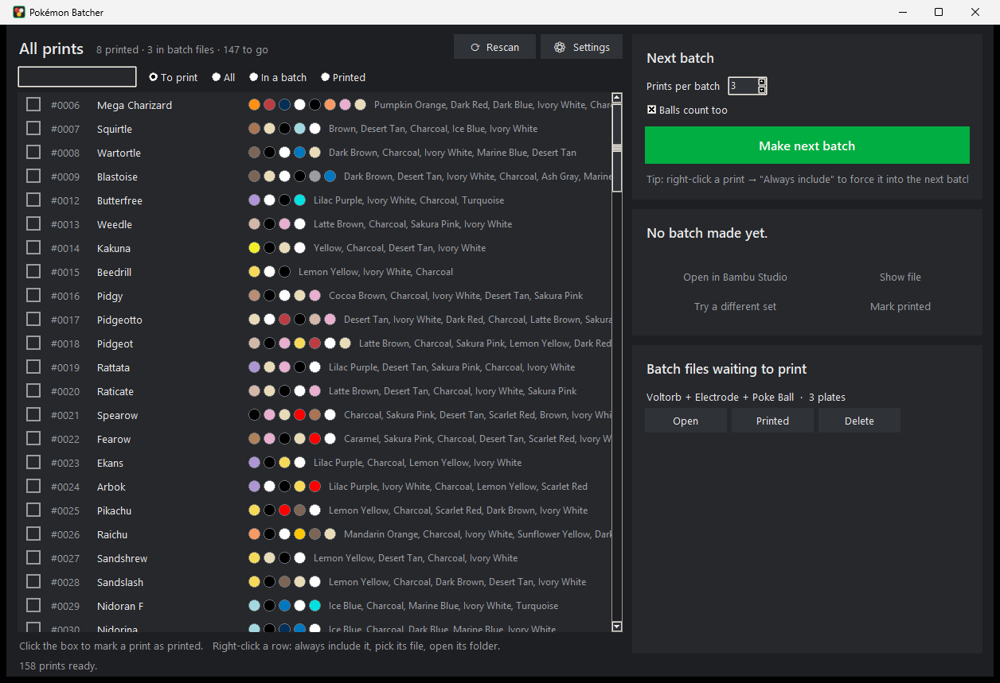

# Pokémon Batcher

Print a big Pokémon collection on a Bambu Lab printer with fewer filament swaps.

Many Pokémon models come as **SPLIT profile** 3MF files: one plate per colour, so a
single-nozzle printer without an AMS can print them. With 150 Pokémon that adds up to
hundreds of nearly empty plates. Pokémon Batcher picks the next few Pokémon you haven't
printed yet that share the most colours. It then writes them into **one Bambu Studio
project with one plate per colour**: all the red parts together, all the white parts
together, and so on.



## What it does

- **Finds your models.** Point it at the folder (or folders) holding your downloads. It
  searches every sub-folder and zip and works out which Pokémon each file is from its
  number and name (`#0025 Pikachu`, `0025 - Pikachu - SPLIT Profile - V3.3mf`, …). Poké
  Balls and other SPLIT models are picked up too. The files don't need to be sorted first.
- **Reads the colours** of every plate, merging spelling variants such as "Bambu Ivory
  White" and "bambnu ivory white". Unnamed plates are named from their filament colour.
- **Picks the batch.** **Make next batch** tries every combination of the prints you
  haven't printed yet and keeps the one that needs the fewest plates. **Try a different
  set** shows the next best one.
- **Writes the file.** Every part becomes its own object, so you can still move or
  delete single parts in Bambu Studio. Parts are packed onto the plates and keep their
  orientation and supports, including support blockers.
- **Tracks progress.** Tick prints off as you print them. A Pokémon that sits in a waiting
  batch file isn't suggested again until that batch is marked printed or its file is
  deleted. On Windows the app can also put a green tick on the Pokémon's folder in
  Explorer.

## Install

1. Install [Python](https://www.python.org/downloads/) 3.10 or newer. On Windows, tick
   "Add python.exe to PATH" in the installer.
2. Download this repository (green **Code** button → **Download ZIP**) and unzip it, or
   `git clone` it.
3. Install the one dependency:

   ```
   pip install -r requirements.txt
   ```

4. Start the app by double-clicking **`Pokemon Batcher.pyw`**, or run `python app.py`.

On the first start, the app asks for the folder your model files are in. You can change
it later under **⚙ Settings**, where you also set where batch files are saved and where
Bambu Studio is installed (it's found automatically in the usual places).

## Using it

1. Leave **Prints per batch** at 3, or change it. **Balls count too** decides whether balls
   can be picked.
2. Click **Make next batch**. The file is written to your batch folder.
3. Click **Open in Bambu Studio**, then slice and print each plate.
4. When it's done, click **Mark printed**.

Right-click a print in the list to always include it in the next batch, to choose which
file to use when a Pokémon has several (for example a "No Spoons" version), or to open
its folder.

There's also a command-line version. `python cli.py 3` prints the ranking and writes the
best batch of 3.

## Good to know

- The batch file takes its printer and process settings from the first model in it. The
  models this was built for are set up for the 256 mm bed of the P1S/X1. On a smaller
  printer, switch the printer in Bambu Studio and re-arrange the plates.
- The first batch that includes a big Pokémon takes a little longer, because every part
  is measured once and then cached.
- Settings, the list of printed prints and the caches live in your user data folder
  (`%LOCALAPPDATA%\Pokemon Batcher` on Windows), not next to the code. Models found
  inside zips are unpacked into the same folder.
- Always check the plates in Bambu Studio before printing.

## Not affiliated

This is a fan-made tool. It doesn't include any models: you need your own copies of
the 3MF files. Pokémon and Poké Ball are trademarks of Nintendo, Creatures Inc. and GAME
FREAK inc. Bambu Lab and Bambu Studio are trademarks of Bambu Lab. This project isn't
affiliated with or endorsed by any of them.

## License

[MIT](LICENSE)
